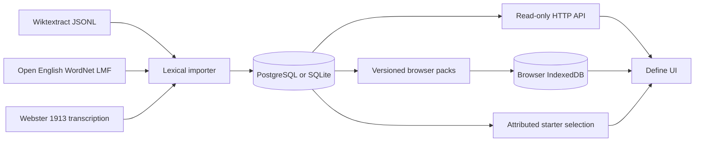

# Architecture

The static shell is served directly from `apps/define/index.html`. It uses vanilla JavaScript, system typography, and app-local assets. GitHub Pages presents the bundled starter. The local and self-hosted editions can mount the same shell and an API on one origin.

`dictionary.js` offers the same asynchronous `lookup(word)` and `search(word, options)` interface across all three browser adapters. `index.js` renders returned records as text and handles navigation, comparisons, provenance, and pack controls. The app prefers a healthy same-origin API, then a verified active offline pack, then the bundled starter. The backend includes exact sense and relation endpoints.

The dictionary service worker matches explicit shell paths under its own scope. It uses a cache prefix that includes the deployment path. The repository home worker now retires its own old caches by prefix. Other same-origin workers that clear origin-wide Cache Storage can still evict a dictionary shell until an online visit reinstalls it. Dictionary packs live independently in IndexedDB.

Root integration consists of the app registry entry, the home service worker version and cleanup scope, and the root README’s app listing and technology notes.
